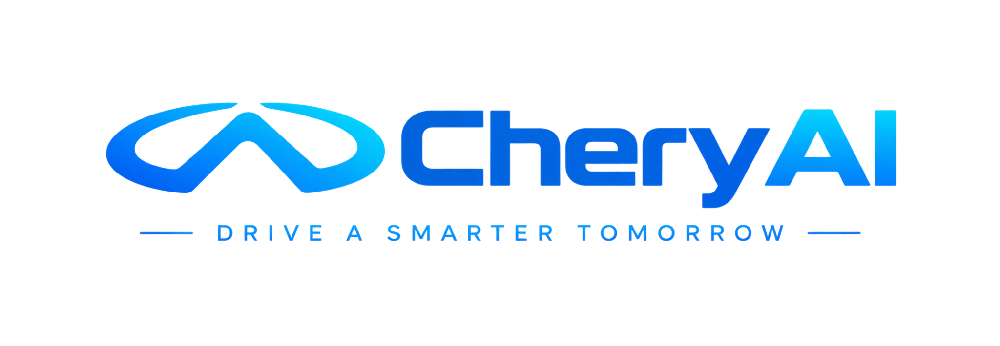
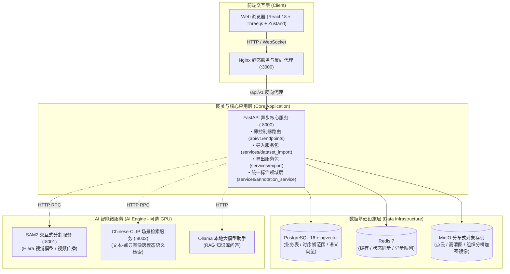

<p align="center">
  
</p>

<h1 align="center">CheryGT · 自动驾驶多传感器融合数据标注与闭环平台</h1>

<p align="center">
  <b>Production-Grade Sensor Fusion Annotation & Data Closed-Loop Platform for Autonomous Driving</b>
</p>

<p align="center">
  
  
  
  
  
  
  
  
  
  
  
</p>

---

## 📖 项目简介 (Overview)

**CheryGT** 是一套专为自动驾驶研发打造的开源、工业级多传感器融合感知数据标注与数据闭环工作台。平台原生支持 **LiDAR 激光雷达点云** 与 **多路环视相机（Camera）图像** 的联合标注，具备实时 3D ↔ 2D 几何投影、时序多目标跟踪（MOT）、AI 辅助半自动标注（SAM2 / CLIP）、细粒度多级人机协同审核流（QA Workflow）与全流程数据闭环流转能力。

### 为什么选择 CheryGT？
- **4D 多传感器融合**：支持 LiDAR 点云与多路环视相机在毫米级标定矩阵下的实时几何投影，实现 3D 框在 2D 视角中的高保真回显与正交多视角（BEV / Side / Front）精准微调。
- **智能化标注飞轮**：集成 Meta SAM2 图像/视频时序分割大模型与 Chinese-CLIP 跨模态场景检索，大幅降低手动标注门槛。
- **工业级可靠架构**：后端采用领域驱动设计（DDD），实现千万级点云分块加载、低内存流式 Zip 导出与大容量异步后台导入任务调度；前端采用 React 18 + Three.js + Zustand 打造高性能画布，毫秒级响应。
- **完备数据闭环**：贯穿 **活动 (Campaign) → 数据集 (Dataset) → 场景 (Scene) → 任务 (Task) → 质检审核 (QA) → 多格式导出 (Export)**，提供完备的 RBAC 角色体系与生产运维看板。

---

## 📑 目录 (Table of Contents)

1. [核心功能特性](#-核心功能特性-features)
2. [系统整体架构](#-系统整体架构-architecture)
3. [快速上手（Docker）](#-快速上手-quick-start)
4. [数据导入与导出管线](#-数据导入与导出管线-data-pipelines)
5. [AI 智能辅助微服务（SAM2 / CLIP）](#-ai-智能辅助微服务-ai-assist)
6. [快捷键指南](#-快捷键指南-keyboard-shortcuts)
7. [环境变量与配置说明](#-环境变量与配置说明-configuration)
8. [代码组织与工程目录](#-代码组织与工程目录-project-structure)
9. [本地开发与测试门禁](#-本地开发与测试门禁-development--testing)
10. [开源协议与致谢](#-开源协议与致谢-license)

---

## 🌟 核心功能特性 (Features)

### 1. 多模态标注工具集 (Multi-Modal Annotation)
* **3D Cuboid 目标检测**：
  * 支持 6 自由度（XYZ 空间位姿 + Yaw / Pitch / Roll 航向倾角）精准编辑；
  * 提供自车航向对齐（Heading Yaw Locked）的局部坐标轴微调，支持键盘 `←`/`→`/`↑`/`↓` 步进（步长 0.05m / 精细 0.01m）。
* **2D 图像感知标注**：
  * 支持 2D 矩形包围盒、多段线（Polyline）、贝塞尔平滑车道线（Lane）、多边形（Polygon）与关键点（Keypoints）。
* **3D 点云语义分割 (Semantic Segmentation)**：
  * 支持百万级点云逐点语义打标，提供笔刷与立体框选工具；
  * 专有 SemanticKITTI 格式 `.label` 文件实时解析与增量保存。
* **AI 交互式分割 (SAM2 Integration)**：
  * 图像点击即分割（Click-to-Segment）与框选分割（Box Prompt）；
  * 跨帧时序视频传播（Video Propagation）与 2D-to-3D 空间反投影联动。

### 2. 多传感器空间与时序对齐 (Sensor Fusion & 4D Tracking)
* **实时几何投影**：基于精确内参及 LiDAR-to-Camera 外参，3D 立体框自动透视投影至所有对应相机画面中。
* **多重视角协同联动**：支持 3D 主视角与 Top (BEV)、Side、Front 三路正交切片视图协同交互。
* **4D 时序多目标追踪 (MOT)**：
  * 跨帧轨迹管理与关键帧自动插值平滑（Keyframe Interpolation）；
  * 关键帧采样模式（Keyframe-Only Mode）与步长跳帧标注（如每 10 帧采样）；
  * 4D 点云时序叠加渲染与多轨迹合并去重。

### 3. 数据闭环与审核治理 (Workflow, QA & Governance)
* **四阶审核流转**：标注员提交 (Annotation) → 内部质检 (QA) → 客户质检 (Customer QA) → 最终归档 (Accepted)。
* **问题标注与质检标记**：支持逐帧标注质疑、驳回重标、假阴性（漏标）反馈与历史快照回溯。
* **企业级权限管理**：内置 5 种角色体系（Admin、PM、Annotator、QA、Customer QA），支持 OIDC/SSO（Google, Keycloak, Okta, Azure AD）。
* **生产效率看板**：内置标注效率统计、人效产出趋势与每日产能分析看板。

---

## 🏗 系统整体架构 (Architecture)

CheryGT 采用分层解耦的云原生微服务架构，核心业务栈与计算密集型 AI 模型物理隔离：



### 核心设计原则
1. **领域驱动与薄控制器**：HTTP 控制器仅负责参数校验与响应封装，复杂序列化与底层打包下沉至领域服务包（例如 `services/export/` 与 `services/dataset_import/`）。
2. **前后端类型契约自动同步**：前端基于 OpenAPI Spec 自动生成完整的 TypeScript 接口与类型定义（`npm run check:api` 门禁保证零类型漂移）。
3. **单向数据流与高性能渲染**：前端 Three.js 点云画布与 React 状态解耦，双级异步预取缓存（LidarCache / ImageCache）保证毫秒级切帧。

---

## 🚀 快速上手 (Quick Start)

### 1. 环境准备
* **Docker** 24.0+ 与 **Docker Compose** v2
* 基础运行内存：建议 ≥ 4 GB 可用内存
* （可选）NVIDIA GPU 与 `nvidia-container-toolkit`（用于启用本地 SAM2 / CLIP GPU 推理）

### 2. 一键启动核心服务

```bash
# 1. 克隆代码仓库
git clone git@github.com:RingKing1/caliperai-gt.git
cd caliperai-gt

# 2. 配置环境变量（复制模板并生成安全密钥）
cp .env.example .env
# 请编辑 .env 修改 SECRET_KEY（需 ≥ 32 字符）以及数据库和 MinIO 密码

# 3. 启动核心服务群（Postgres, Redis, MinIO, Backend, Frontend）
docker compose up -d postgres redis minio backend frontend

# 4. 创建系统初始管理员账号
docker compose exec backend python scripts/create_admin.py \
  --email admin@chery.com \
  --username admin \
  --password 'CheryGT@2026'

# 5. 验证服务运行状态
docker compose ps
curl -s http://localhost:8000/health
```

### 3. 访问应用

**公网访问（团队推荐）**

| 用途 | 地址 | 说明 |
|---|---|---|
| 标注平台 | [https://gt.wanghuan.site](https://gt.wanghuan.site) | Cloudflare Tunnel 暴露，**已取消 Zero Trust 拦截**，打开即用 |
| 数据集直达 | https://gt.wanghuan.site/datasets/e464e448-52a9-43a7-a738-dcae4249f40c | scene1 5-sweep，20 个场景 |

**内网访问**

| 用途 | 地址 |
|---|---|
| 局域网 | http://10.105.213.208:3000 |
| 本机 | http://localhost:3000 |
| 交互式 API 文档 | http://localhost:8000/api/docs （开发环境） |
| 健康检查 | http://localhost:8000/health |

> [!IMPORTANT]
> `gt.wanghuan.site` 原先由 Cloudflare Access（Zero Trust）保护，仅允许指定邮箱登录。
> 该 Access 应用已于 2026-10-23 删除，现在**公网可直接访问**，仅依赖平台自身的账号密码鉴权。
> 应用配置备份在 `../cloudflare_backup/`，如需恢复保护可按备份重建。

> [!TIP]
> **忘记管理员密码？**
> 可再次执行管理员脚本并追加 `--reset-password` 参数进行安全重置：
> ```bash
> docker compose exec backend python scripts/create_admin.py \
>   --username admin --password '新密码' --reset-password
> ```

---

## 📦 数据导入与导出管线 (Data Pipelines)

CheryGT 提供灵活多样的数据流入与产出管线，满足自动驾驶数据工厂各种工况需求。

### 1. 场景包导入（Scene ZIP Bundle）
标准的场景数据以 `.zip` 文件打包，支持包含点云、多路相机图片、几何标定与自车位姿轨迹：

```text
scene_bundle.zip
├── lidar/            # frame_000000.pcd (或 .bin), frame_000001.pcd ...
├── cameras/          # front/, left_front/, right_front/ ... (JPG/PNG)
├── calibration.json  # LiDAR ↔ 相机内外参矩阵及相机畸变参数 (可选)
└── ego_poses/        # 包含每帧自车位姿轨迹信息的 JSON (可选)
```

### 2. 纯视频轻量化导入（Video Ingestion）
对于仅需 2D 感知或测试验证的场景，支持直接上传常见的视频格式（`MP4`、`AVI`、`MOV`、`MKV`、`WebM`）：
* **同步抽取导入**：`POST /api/v1/import/upload-video` 适合短小测试片段；
* **异步后台 Job 导入（推荐）**：`POST /api/v1/import/jobs/video` 适合大容量长视频。上传后立即返回 `202 Accepted` 与 `job_id`，后台工作线程切帧解算并实时推送进度，通过 `GET /api/v1/import/jobs/{id}` 轮询，杜绝 HTTP 阻塞超时。

### 3. 多标准格式高速流式导出（Multi-Format Export）
平台内置高内聚的导出领域服务（`app/services/export`），采用 `io.BytesIO` 与流式 Zip 压缩，极大优化内存占用：
* **COCO Per-Sensor 格式**：为 LiDAR 3D 目标及各路环视相机独立生成标准 COCO 格式 JSON（支持相机截锥过滤与 2D/3D 关联）；
* **SemanticKITTI 分割格式**：点云逐点语义分割文件以 `.label` 二进制流打包导出，严格兼容 KITTI 规范；
* **平台全量标注 JSON**：包含 3D 框、2D 框、车道线、4D 时序轨迹及质量审核状态的完整元数据。

---

## 🤖 AI 智能辅助微服务 (AI Assist)

平台支持通过微服务引入基础感知大模型加速标注：

```bash
# 1. 下载 SAM2 权重文件（支持 large / base / small / tiny）
python backend/scripts/download_sam2_models.py --size large --output-dir ./models/sam2

# 2. 启动 GPU 加速服务
docker compose -f docker-compose.yml -f docker-compose.gpu.yml up -d sam2 backend

# 或在无独立 GPU 环境下启动 CPU 备用服务：
docker compose -f docker-compose.yml -f docker-compose.sam2.yml up -d sam2 backend
```

* **SAM2 接口健康检查**：`curl http://localhost:8001/health`
* **中文 CLIP 跨模态微服务**：`docker compose -f docker-compose.yml -f docker-compose.clip.yml up -d clip`，健康检查：`curl http://localhost:8002/health`。

---

## ⌨️ 快捷键指南 (Keyboard Shortcuts)

在标注编辑器（`FusionEditorV2`）中熟练使用快捷键可大幅提升作业人效：

### 1. 核心工具与标绘
| 快捷键 | 功能操作 | 快捷键 | 功能操作 |
|:---|:---|:---|:---|
| `V` | 选择与漫游工具 | `C` | 3D Cuboid 标绘工具 |
| `B` | 2D 矩形框工具 | `L` | 车道线 / 多段线工具 |
| `P` | 多边形工具 | `W` | AI 智能分割（SAM2） |
| `T` | 轨迹关联工具 | `Space` | 播放 / 暂停时序回放 |
| `Ctrl+S` / `Cmd+S` | 保存当前标注数据 | `Delete` / `Backspace` | 删除选中标注 |

### 2. 3D 立体框姿态精细微调（选中状态）
| 快捷键 | 视图模式 | 调整维度与方向 |
|:---|:---|:---|
| `Q` / `E` | 全局视图 | 航向角 Yaw 旋转（±5°；按住 `Shift` 为 ±1°） |
| `W` / `S` | 全局视图 | 沿物体长轴缩放 Length（±0.1m） |
| `A` / `D` | 全局视图 | 沿物体宽轴缩放 Width（±0.1m） |
| `Z` / `X` | 全局视图 | 沿物体高轴缩放 Height（±0.1m） |
| `R` | 全局视图 | 重置俯仰与翻滚角（Reset Pitch/Roll） |
| **`→` / `←`** | **俯视 (BEV) 视图** | **沿物体局部朝向 前进 / 后退 (±0.05m；`Shift` 为 ±0.01m)** |
| **`↑` / `↓`** | **俯视 (BEV) 视图** | **沿物体局部朝向 向左 / 向右 平移 (±0.05m；`Shift` 为 ±0.01m)** |
| `↑` / `↓` | 侧视 / 前视视图 | 沿空间绝对高度轴 Z 平移 (±0.05m) |

### 3. 时序导航与 QA 审核
| 快捷键 | 适用场景 | 说明 |
|:---|:---|:---|
| `←` / `→` | 未选定标注时 | 切换到上一帧 / 下一帧（自动适配抽帧步长） |
| `1` | QA 审核模式 | 批准通过当前标注 (Approve) |
| `2` | QA 审核模式 | 驳回重标 (Reject) |
| `3` | QA 审核模式 | 标记存疑问题 (Flag Issue) |
| `F` | QA 审核模式 | 标记漏标物体 (Flag Missing Object) |

---

## ⚙️ 环境变量与配置说明 (Configuration)

核心变量维护在根目录 `.env` 中，主要配置项如下：

| 配置变量 | 作用说明 | 生产推荐值 / 示例 |
|:---|:---|:---|
| `SECRET_KEY` | JWT 鉴权加盐密钥 | **必须替换为强随机字符串（≥ 32 字符）** |
| `POSTGRES_PASSWORD` | PostgreSQL 访问密码 | 自定义强密码 |
| `MINIO_ROOT_USER` / `MINIO_ROOT_PASSWORD` | MinIO 对象存储根密钥 | 自定义凭证 |
| `OBJECT_STORAGE_ACCESS_KEY` / `SECRET_KEY` | 后端连接 MinIO 的 Access Key | 与 MinIO ROOT 凭证保持一致 |
| `CORS_ORIGINS` | 跨域允许来源白名单 | 生产设为真实域名（如 `https://gt.chery.com`） |
| `BUILD_TARGET` | 构建模式 | 开发填 `development`，生产填 `production` |
| `FEATURE_*` | 功能特性开关门禁 | 可在 `deploy/features/` 中按环境批量定义 |
| `BRAND_*` | 品牌客制化配置 | 控制前端显示品牌文字与样式 |

---

## 📂 代码组织与工程目录 (Project Structure)

```text
caliperai-gt/
├── backend/                            # 后端服务根目录
│   ├── app/
│   │   ├── api/v1/                     # API 控制器层
│   │   │   ├── router.py               # 集中路由注册表
│   │   │   └── endpoints/              # 薄路由模块 (export.py, import_data.py, tasks.py ...)
│   │   ├── services/                   # 核心业务领域服务
│   │   │   ├── export/                 # ★ 导出领域包 (merge, archive, coco, segmentation)
│   │   │   ├── dataset_import/         # ★ 导入领域包 (video_pipeline, runner, jobs, parser)
│   │   │   ├── annotation_service.py   # 统一标注写入业务门面
│   │   │   ├── efficiency/             # PM 看板及产工人效分析服务包
│   │   │   └── sam2_service.py         # SAM2 通信客户端
│   │   ├── models/                     # SQLAlchemy 2.0 异步模型层
│   │   ├── schemas/                    # Pydantic v2 请求/响应数据校验层
│   │   └── core/                       # 基础配置、数据库/Redis 连接池、文件安全审计
│   ├── alembic/                        # 数据库迁移脚本
│   ├── tests/                          # 自动化测试用例集 (pytest)
│   └── scripts/                        # 管理员创建与系统初始化运维脚本
├── frontend/                           # 前端工程根目录
│   ├── openapi/                        # OpenAPI 契约快照 (spec.json)
│   ├── src/
│   │   ├── components/canvas/          # 3D 点云画布、三重视角切片及 2D 绘图组件
│   │   ├── pages/                      # 核心页面 (FusionEditorV2, 数据看板, 分类法等)
│   │   ├── types/generated/            # 由 OpenAPI 自动生成的 TypeScript 类型 (勿手改)
│   │   ├── store/                      # Zustand 客户端状态仓库
│   │   └── hooks/                      # 标定投影、时序播放与快捷键等业务 Hook
│   └── public/                         # 静态资源与 CheryGT 品牌矢量图标
├── microservices/                      # 独立 GPU 微服务 (SAM2, CLIP)
├── deploy/                             # 生产部署配置与特性开关模板
├── docs/                               # 深度技术规格书与使用文档
├── docker-compose.yml                  # 核心基础开发编排
├── docker-compose.prod.yml             # 生产多阶段镜像编排
└── docker-compose.gpu.yml              # GPU 加速微服务覆盖编排
```

---

## 🧪 本地开发与测试门禁 (Development & Testing)

### 1. 后端单元测试与代码检查
项目具备高标准测试覆盖率，所有修改均需通过自动化回归：

```bash
# 进入容器或在本地执行全部测试
docker exec anno-backend pytest -q

# 执行单文件或特定领域测试
docker exec anno-backend pytest tests/test_export_service.py -v
docker exec anno-backend pytest tests/test_import_jobs.py -v

# 代码风格与静态类型检查 (Ruff)
docker exec anno-backend ruff check app/
```

### 2. 前端契约门禁与类型同步
前端杜绝手动维护后端接口，通过契约自动化命令与后端 OpenAPI 严格同步：

```bash
cd frontend
# 1. 从运行中的后端拉取最新的 openapi.json
npm run fetch:api

# 2. 离线重新生成 TypeScript 类型定义
npm run gen:api

# 3. 运行漂移检查门禁（CI 流程自动化执行）
npm run check:api
npm run build
```

---

## 📄 开源协议与致谢 (License)

本项目基于 **[Apache License 2.0](LICENSE)** 许可开源。
欢迎对自动驾驶多传感器融合感知及数据闭环生态感兴趣的开发者提交 Issue 和 Pull Request，共同打造更加稳健、智能的下一代自动驾驶标注平台！
