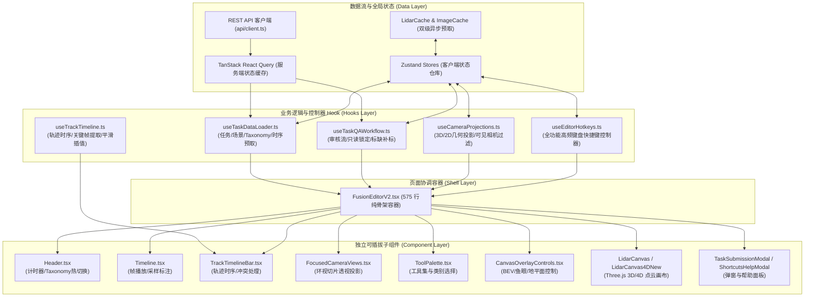

# CaliperAI-GT 前端架构设计与开发文档

## 1. 架构概览 (Overview)

CaliperAI-GT 前端是面向自动驾驶感知数据闭环的 **4D 多模态多传感器融合标注工作台**。核心支持 LiDAR 3D 点云、4D 时序点云融合、环视 6 相机 2D 图像、多目标连续轨迹（3D Multi-Object Tracking）、AI 语义分割（SAM2）联动标注与质量审核（QA）。

前端采用现代响应式架构，以 **“单向数据流 + 关注点分离（SoC）+ 骨架容器组件”** 为核心设计原则。



---

## 2. 技术栈选型 (Technology Stack)

| 领域 | 技术方案 | 作用说明 |
| :--- | :--- | :--- |
| **基础框架** | React 18 + TypeScript 5 | 组件化 UI 与严格静态类型系统 |
| **构建工具** | Vite 5 | 毫秒级 HMR 模块热重载与 Rollup 生产打包 |
| **3D 渲染** | Three.js (`@react-three/fiber`, `@react-three/drei`) | WebGL 高性能点云渲染、空间旋转缩放与相机变换 |
| **2D 标注画布** | Konva + `react-konva` | Canvas 高性能 2D 矩形框/多边形/骨骼标注交互 |
| **客户端状态** | Zustand 4 | 轻量、无样板代码的跨组件实时状态分发 |
| **服务端状态** | TanStack React Query v5 | 自动缓存、请求去重、失败重试与响应式失效刷新 |
| **样式系统** | TailwindCSS 3 + PostCSS | 原子化样式体系，支持主题快速扩展与高分辨率缩放 |
| **路由** | React Router v6 | 单页应用路由管理与 URL 查询参数绑定 |

---

## 3. 目录结构规范 (Directory Structure)

```text
frontend/src/
├── api/                   # REST API 客户端定义 (Axios 封装、请求拦截与类型声明)
│   └── client.ts          # 统一后端接口定义 (Tasks, Scenes, Annotations, QA 等)
├── components/            # UI 组件库
│   ├── canvas/            # 画布渲染器
│   │   ├── LidarCanvas/   # Three.js 3D 点云渲染器、点云着色器、裁切框 (ClipBox)
│   │   ├── OrthographicViews/ # 正交三视图 (Top/Side/Front 正交投影视角)
│   │   └── ImageCanvas.tsx    # 2D 相机底图渲染
│   ├── editor/            # 标注工作台解耦子组件
│   │   ├── Header.tsx                 # 顶部导航栏、工作计时系统、Taxonomy 多标签热切换
│   │   ├── Timeline.tsx               # 底部时序播放器、关键帧抽样标注（Sampling）
│   │   ├── TrackTimelineBar.tsx       # 连续轨迹时间线、框冲突智能解决、并轨/断开
│   │   ├── FocusedCameraViews.tsx     # 选中 3D 框时的 6 相机动态聚焦切片与投影
│   │   ├── FusionLabelingView.tsx     # 2D/3D 融合联动标注面板
│   │   ├── ToolPalette.tsx            # 左侧浮动工具栏、类别快捷选板 (ClassPickerPanel)
│   │   ├── CanvasOverlayControls.tsx  # 画布左上浮动控制（BEV、鱼眼/针孔、地平面）
│   │   ├── CoordinateDisplay.tsx      # 点云三维光标坐标悬浮胶囊
│   │   ├── CuboidPlacementHint.tsx    # 首次框选交互引导提示
│   │   ├── TaskSubmissionModal.tsx    # 任务提交成功确认与下一任务连续流转弹窗
│   │   ├── ShortcutsHelpModal.tsx     # 全功能快捷键/鼠标交互帮助面板
│   │   └── types.ts                   # 编辑器内部专属类型定义 (ViewMode, ToolType 等)
│   └── qa/                # QA 质量审核面板 (TabbedQAPanel, 驳回弹窗, 标缺补标等)
├── hooks/                 # 核心定制业务 Hook
│   ├── useTaskDataLoader.ts     # 任务、场景、Taxonomy、预取与数据初始化
│   ├── useTaskQAWorkflow.ts     # 审核会话、锁定校验、标缺/补标流转
│   ├── useCameraProjections.ts  # 3D 框投影至各相机、视场内相机筛选、点云反查
│   ├── useEditorHotkeys.ts      # 全局键盘事件分发与快捷键映射
│   ├── useTrackTimeline.ts      # 目标追踪时序数据抽取与线性插值
│   └── useAutoSave.ts           # 标注草稿静默自动存盘 Hook
├── store/                 # Zustand 状态仓库
│   ├── editorStore.ts     # 主标注状态 (点云视角、选中框、当前帧、Taxonomy)
│   ├── trackStore.ts      # 连续追踪轨迹树与当前高亮轨迹
│   ├── qaStore.ts         # QA 审核状态与批注数据
│   ├── lidarCacheStore.ts # 点云预取缓存（LRU/内存池）
│   └── imageCacheStore.ts # 相机高分辨率图片异步预解码缓存
├── types/                 # 全局业务领域类型 (PointCloudData, CuboidData, BBox2D, Task 等)
│   ├── generated/         # ★ 后端 OpenAPI 自动生成的契约类型（勿手改，见 §6.4）
│   ├── auth.ts / chat.ts / index.ts  # 手写类型，逐步改为 generated 别名
└── utils/                 # 工具函数
    ├── projection.ts      # 3D-2D 针孔相机与 KB4 鱼眼模型透视投影核心数学库
    ├── interpolation.ts   # 3D 目标追踪连续帧平滑插值算法
    └── cuboidDimensions.ts# 类别默认框长宽高几何参数映射
```

---

## 4. 巨石组件重构实践 (Refactoring Design)

### 4.1 历史痛点
历史代码中 `FusionEditorV2.tsx` 膨胀至 **10,356 行（近 500 KB）**，杂糅了：
1. 3D 点云渲染器与正交投影逻辑；
2. 环视 6 相机外参/内参投影映射；
3. 全局近 2,000 行键盘与快捷键监听器；
4. 7,000+ 行早期废弃内联死代码（如 `_TrackManagement`, `_PropertiesPanel`）；
5. 异步预取、自动保存、QA 审核等混合状态。

### 4.2 渐进式解耦策略 (Progressive Decoupling)
重构严格贯彻 **“黄金基准原则（零功能倒退）”** 与 **“分治解耦”**：
1. **清理无效死代码**：彻底下线已弃用的 7,000+ 行冗余代码；
2. **抽取纯交互组件**：将 `Header`、`Timeline`、`TrackTimelineBar`、`FocusedCameraViews`、`ToolPalette`、`CanvasOverlayControls`、`ShortcutsHelpModal` 等 11 个子组件完全独立落地；
3. **抽取业务控制器 Hook**：
   - 数据加载：[`useTaskDataLoader`](hooks/useTaskDataLoader.ts)
   - 审核流转：[`useTaskQAWorkflow`](hooks/useTaskQAWorkflow.ts)
   - 几何投影：[`useCameraProjections`](hooks/useCameraProjections.ts)
   - 键盘监听：[`useEditorHotkeys`](hooks/useEditorHotkeys.ts)
4. **收敛为极简纯骨架**：
   - [FusionEditorV2.tsx](pages/FusionEditorV2.tsx) 最终精简至 **575 行**（代码瘦身超过 **94.4%**），不再直接操作网络层，仅专注于组装子组件与分发上下文。

---

## 5. 核心业务流水线与交互机制

### 5.1 异步预取与流水线播放 (Rolling Prefetch Pipeline)
为了保证 4D 点云和多相机高分辨率图片在时序切换时不卡顿：
1. **窗口化点云预取**：`useTaskDataLoader` 在首帧初始化时加载 $\pm 10$ 帧的 PCD 点云，用户导航时由 `lidarCacheStore` 在后台悄然滑动更新预取窗口；
2. **离线 Blob 缓存与即时解码**：`imageCacheStore` 将 6 相机图片预先加载为内存 Blob URL，并在后台实例化 `new Image()` 触发浏览器的预解码机制，实现切帧秒开。

### 5.2 3D-2D 几何双向联动 (Bidirectional Projection)
1. **3D 到多相机投影**：选中三维点云框（Cuboid）时，`useCameraProjections` 利用外参矩阵 $T_{\text{lidar}\to\text{cam}}$ 与相机内参 $K$（支持标准针孔模型与 Kannala-Brandt 鱼眼畸变模型）计算 8 个顶点的像素坐标，并裁剪出包围盒；
2. **视场可见性计算**：[`findVisibleCamerasForCuboid`](utils/projection.ts) 根据可见角点数量自动筛选出覆盖该物体的相机列表，在下方面板进行多视角联动聚焦呈现；
3. **点云空间反查相机**：在点云空白处单击任意三维点，[`findBestCameraForPoint`](utils/projection.ts) 可瞬时找出正对该点且畸变最小的最佳视角相机。

### 5.3 4D 目标连续追踪与智能冲突解决 (Track Timeline & Conflict Handling)
1. **轨迹时序流**：[TrackTimelineBar.tsx](components/editor/TrackTimelineBar.tsx) 独立掌控单目标追踪状态，支持在连续帧中标记 Keyframe（关键帧）、Normal（插值帧）与 Empty（空帧）；
2. **冲突仲裁**：在两段轨迹缝合或多帧重叠时，采用 **“主轨迹优先”** 原则直接覆盖生效，次轨迹非重叠帧予以保留，重叠框保留原有 Track ID 以便后续继续并轨，杜绝繁琐确认弹窗。

---

## 6. 本地开发与容器化构建 (Development & Build)

### 6.1 开发环境依赖
- Node.js >= 20.0.0
- Docker & Docker Compose v2

### 6.2 容器化构建与快速验证（推荐）
前端服务集成在全栈 Docker 编排中，生产镜像基于 Node 20 编译并通过 Alpine Nginx 托管：

```bash
# 1. 编译前端生产镜像 (触发 strict 模式类型检查与 Vite 生产打包)
docker compose build frontend

# 2. 启动前端容器
docker compose up -d frontend

# 3. 验证服务状态
curl -I http://localhost:3000
```

### 6.3 严格静态检查规范
前端开启了最严格的 TypeScript 编译选项（`noUnusedLocals: true`, `noUnusedParameters: true`, `strict: true`）。在提交或合并前，必须确保 0 警告、0 错误。

### 6.4 OpenAPI → TypeScript 契约类型
后端契约的 canonical 类型由 [openapi-typescript](https://github.com/drwpow/openapi-typescript) 从 OpenAPI 文档生成，消除前后端手写类型漂移：

```bash
npm run fetch:api    # 从运行中的后端（默认 http://localhost:8000）拉取最新 openapi.json
npm run gen:api      # 由 openapi/spec.json 重新生成 src/types/generated/api.ts
npm run check:api    # 漂移门禁：重新生成并与已提交文件逐字节对比（CI 用）
```

- `openapi/spec.json` 与 `src/types/generated/api.ts` 均提交入库，生成过程离线可复现；
- 消费方式：`import type { components, Schema } from '@/types/generated'`，
  如 `type Task = Schema<'TaskResponse'>` 或 `components['schemas']['SceneListResponse']`；
  需要按路径取请求/响应类型时用 `paths['/api/v1/tasks/{task_id}']['get']`；
- 手写类型（`types/index.ts` 等）按域逐步替换为生成类型的别名，不做一次性大爆炸迁移；
  已接入：`LoginRequest` / `ChangePasswordRequest` / `UserRole` / `AuthUser`(基于
  `CurrentUserResponse`，收窄 role/permissions) / `LoginResponse`(基于 `Token`)、
  枚举（`TaskStatus`、`TaxonomyAnnotationMode`、`ReviewVerdict` 等）、`BBox2D`、
  `ExtrinsicCalibration`、标注统计全家桶、QA 评审/建议、`ChatMessage`、
  `User`、`Campaign`/`CampaignCreateRequest`/`CampaignUpdateRequest`、`Dataset`、
  `DatasetStats`、`DatasetDetailResponse`、`Frame`、`Task`/`TaskConfig`、`ImportJob`、
  `SharedAttributeDefinition`。后端改 schema 后流程：
  `fetch:api` → `gen:api` → 提交两个文件（`check:api` 会拦截漏提交）。

- 已确认的契约分叉，暂保留手写类型（不是漏替换）：
  - `IntrinsicCalibration`：前端多 `resolution` / `camera_model`（LidarCanvas 依赖）；
  - `AnnotationType` / `AnnotationSource`：前端并集是后端枚举超集（fusion_box2d、
    qa_correction 等）；`Annotation.data` 后端为 dict，前端为判别联合；
  - `TaskStage` / `QAReviewMode` / `SuggestionSeverity` / `Permission`：后端无组件，
    以自由字符串下发；
  - `Scene` / `SceneCalibration` 链：后端 calibration/storage_paths 为泛化 dict，
    且字段名为 `scene_metadata`，前端依赖强类型结构；
  - `Taxonomy` / `TaxonomyConfig` / `ClassDefinition` 等分类学嵌套：后端嵌套字段
    `null` 与前端 `undefined` 约定不同，边界统一走
    `utils/taxonomyUtils.ts` 的 `normalizeTaxonomyConfig` /
    `normalizeSharedAttributes` 归一化后再入 store；
  - Chat SSE 事件、编辑器内部类型（ViewState/store 类型、标注 payload）不属 API 契约。

- CI：`.github/workflows/frontend-ci.yml` 在 push/PR 上执行
  `npm ci` → `npm run check:api` → `tsc --noEmit` → `npm test`。
